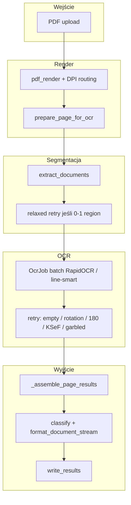

# Pipeline OCR — przepływ szczegółowy

Wejście wspólne: `app/services/pipeline.run_job(job_id, input_path, source_name=…)`.

1. `allocate_result_dir(job_id, source_name)` → `storage/results/{stem}/` (lub `{uuid}/`).
2. `job_store.update(…, results_folder=…, status=PROCESSING)`.
3. Rozgałęzienie po `SourceKind` z `ingest` / rozszerzenia pliku.

---

## 1. Obraz (`.jpg`, `.png`, …) — `SourceKind.IMAGE`

Funkcja: `_process_single_image`.

```text
plik wejściowy
    → (opcjonalnie) upscale / preprocess dla paragonów
    → line-smart OCR (RapidOCR → Tesseract per linia → crop VLM)
       lub legacy page gate → full-page vision
    → postprocess PL (ocr_postprocess)
    → ProcessingResult (1 strona)
    → write_results → result.json + result.txt
```

**Bez segmentacji** — cały kadr to jeden dokument. GPU: `IMAGE_OCR_GPU` (domyślnie 0).

Flagi istotne:

- `OCR_LINE_LEVEL_ENABLED=true` — domyślna ścieżka dokładna.
- `OCR_ENGINE=fast` — tylko RapidOCR, bez eskalacji.
- `--no-vlm` w `run_sample.py` → `allow_vision_escalation=False`.

---

## 2. PDF — `SourceKind.PDF`

Funkcja: `_process_bulk_document`.

### 2.1 Render stron

- `pdf_render` + `pdf_dpi_routing` — DPI per strona (simple / dense / photo-adaptive).
- Zapis: `work_dir/pages_orig/`, `work_dir/pages_enhanced/`.
- `prepare_page_for_ocr` — normalizacja jasności/kontrastu strony.

### 2.2 Segmentacja (`document_segmentation.extract_documents`)

Na każdej stronie:

1. Opcjonalny **OSD / auto-rotate** (`PDF_AUTO_ROTATE`).
2. Wykrycie regionów (OpenCV) — bboxy dokumentów na skanie.
3. **Orientacja regionu** — 0° / 90° / 180° / 270° (probe OCR + heurystyki; `pick_best_cardinal_rotation` dla trudnych przypadków).
4. **Deskew** cropa (`scan_enhance`, `PDF_DESKEW_CROPS`) — mały kąt skosu &lt; ~15°.
5. Hinty layoutu: `ksef_column`, `numbered_form`, itd.

Jeśli po segmentacji jest **≤1 region** na stronie z wieloma paragonami, pipeline **ponawia segmentację** z poluzowanymi progami (`min_area_pct`, `max_regions` ×2).

### 2.3 Plan OCR (`_PagePlan`, `OcrJob`)

Dla każdej strony:

- **Full-page job** (`p{N}:full`) — gdy KSeF / `PDF_SMART_ESCALATE` lub layout kolumnowy.
- **Per-region job** (`p{N}:d{idx}`) — crop każdego regionu.

Silnik na cropach PDF (domyślnie):

- RapidOCR (`OCR_LINE_LEVEL_ON_PDF_CROPS=false`).
- Słabe cropy → line-smart (`OCR_LINE_LEVEL_ESCALATE_BAD_PDF_CROPS=true`).

Równoległość:

- Wiele cropów / stron → `parallel_ocr.run_ocr_jobs` na `OCR_BULK_GPU_IDS`.
- ZIP pinuje cały dokument na jedną kartę (`pinned_gpu`).

### 2.4 Retry po pierwszym OCR (kolejność istotna)

| Krok | Funkcja | Kiedy |
|------|---------|--------|
| Puste cropy | `_retry_empty_regions` | Brak tekstu — mocniejszy preprocess |
| Zły obrót 90/270 | `_retry_wrong_rotation` | `looks_garbled_ocr` + rotation 90/270 |
| Odwrócony tekst 180° | `_retry_inverted_180` | `looks_inverted_reading_order` |
| Kolumny KSeF | `_retry_ksef_columns` | Layout KSeF — osobne OCR kolumn |
| Garbled / merged | `_handle_garbled_regions` | Śmieciowy OCR, wiele paragonów — resplit bbox |
| Obrót kardynalny | (w segmentation / garbled path) | Probe 0/90/180/270° |

### 2.5 Składanie strony — `_assemble_page_results`

- Wybór full-page vs suma regionów (KSeF: preferencja czytelnego full-page).
- **Merge dwóch kolumn jednego dokumentu** (`merge_two_column_document`) — faktury, DOO, formularze numerowane.
- `consolidate_page_blocks` — łączenie sąsiednich bloków tego samego typu (z wyjątkiem `_no_auto_merge`).
- `classify_document` + `format_document_stream` — nagłówki w `result.txt` (Paragon, Faktura, …).

### 2.6 Wynik PDF

`ProcessingResult` z:

- `text` — cały plik,
- `metadata.pages[]` — per strona: engine, czas, DPI, regiony, eskalacja,
- `lines[]` — opcjonalna geometria linii.

---

## 3. ZIP — `SourceKind.ZIP`

Funkcja: `_run_zip_job`.

```text
ZIP upload (storage/uploads/{job_id}_{name}.zip)
    → lista memberów (zip_streaming / ingest)
    → ZipCheckpointStore + checkpoint.json (po każdym pliku)
    → dla każdego membera:
          rozpakuj do work_dir
          ├─ obraz  → _process_single_image (pin GPU)
          ├─ PDF    → _process_bulk_document (pin GPU) lub ZIP_SIMPLE ścieżka
          └─ błąd   → wpis w failures[], job kontynuuje
    → errors.json (jeśli failures)
    → job.json + status done/failed
```

**ZIP simple receipt:** PDF/obraz 1–2 strony, mało regionów → szybsza ścieżka (`ZIP_SIMPLE_RECEIPT_MAX_PAGES`).

**Worker pool:** osobne procesy `spawn`, lock per GPU, recycle co `MAX_DOCS_PER_WORKER`.

---

## 4. Zapis wyników

`write_results(ProcessingResult, result_dir)`:

- `result.json` — Pydantic `ProcessingResult`.
- `result.txt` — tekst po formatowaniu strumienia dokumentów.

Job store: `result_files` = ścieżki względne do projektu.

---

## 5. Diagram (PDF, uproszczony)



---

## 6. Pliki tymczasowe

| Ścieżka | Zawartość |
|---------|-----------|
| `storage/temp/{job_id}/` | Strony PDF, cropy, retry PNG — usuwane w `finally` po `run_job` |
| `storage/ocr_cache/` | Cache hash→tekst OCR (ponowne uruchomienia) |

---

## 7. Powiązane moduły

Szczegółowa mapa: [ARCHITECTURE.md](ARCHITECTURE.md).  
Kontrakt pól: [SCHEMA.md](SCHEMA.md).
