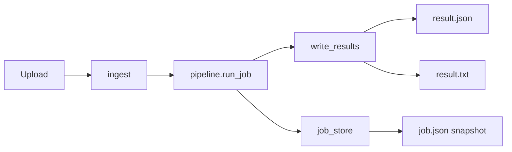

# Kontrakt danych i pliki wynikowe

Aktualizacja: 2026-05-29 (po merge A2 + pipeline v2).

---

## Przepływ danych



---

## `ProcessingResult` → `result.json`

| Pole | Typ | Opis |
|------|-----|------|
| `source` | string | Nazwa pliku wejściowego |
| `source_kind` | `"pdf"` \| `"image"` \| `"zip"` | Typ źródła |
| `processed_at` | ISO datetime | Czas zakończenia |
| `page_count` | int | Liczba stron (PDF) lub 1 (obraz) |
| `language_detected` | string[] | np. `["pl","en"]` |
| `text` | string | **Jeden blok** treści (kompatybilność wsteczna) |
| `lines` | `OcrLine[]` | Geometria linii (może być `[]`) |
| `confidence` | float? | 0–1, średnia |
| `engine` | string | Dominujący silnik: `fast_ocr`, `line_smart`, `tesseract`, `vision_llm`, `hybrid`, … |
| `warnings` | string[] | Ostrzeżenia jakości |
| `metadata` | object | Rozszerzenia (strony, GPU, segmentacja) |

### `OcrLine` (element `lines[]`)

| Pole | Typ | Opis |
|------|-----|------|
| `text` | string | Treść linii |
| `confidence` | float | 0–1 |
| `bbox` | int[4] | `x0,y0,x1,y1` w pikselach strony/cropu |
| `page` | int | Numer strony (1-based) |
| `engine` | string | Silnik dla linii |
| `document` | int? | Indeks regionu na stronie |
| `line_index` | int? | Kolejność linii |
| `escalated` | bool? | Czy użyto eskalacji VLM/line-smart |
| `suspicious` | bool? | Rapid vs Tess disagreement |
| `disagreement` | float? | 0 = zgoda, 1 = totalny rozjazd |
| `rapid_text` / `tesseract_text` | string? | Teksty przed konsensusem |
| `validation_passed` | bool? | Semantyczna walidacja |
| `validation_issues` | object[]? | Szczegóły błędów pól |
| `validation_failed_kinds` | string[]? | np. `nip`, `pesel` |

### `metadata` (typowe klucze)

| Klucz | Opis |
|-------|------|
| `pages` | Lista per strona: `page`, `engine`, `elapsed_sec`, `escalation_reason`, DPI, regiony |
| `ocr_gpu_ids` | Użyte GPU |
| `ocr_parallel` | Czy cropy równolegle |
| `ocr_page_parallel` | Czy strony równolegle |
| `dpi_routing` | Decyzje DPI |
| `document_blocks` | Bloki po klasyfikacji (wewnętrzne) |

Pełna lista zależy od ścieżki (IMAGE vs PDF vs ZIP member).

---

## `JobStatusResponse` (API + Redis)

| Pole | Typ | Opis |
|------|-----|------|
| `job_id` | UUID | Identyfikator w URL API |
| `status` | enum | `queued` → `processing` → `done` \| `failed` |
| `progress` | object? | `current`, `total`, `unit` (`pages` \| `files`), `percent` |
| `created_at` / `updated_at` | datetime | ISO UTC |
| `error` | string? | Błąd globalny lub komunikat częściowego ZIP |
| `results_folder` | string? | Nazwa podkatalogu w `storage/results/` |
| `result_files` | string[] | Ścieżki względne do projektu po `done` |

Przykłady API: [API.md](API.md).

---

## Pliki na dysku

### Pojedynczy PDF / obraz

```text
storage/results/{results_folder}/
├── result.json
├── result.txt
└── job.json          # po done/failed
```

`results_folder` = stem nazwy pliku (gdy `RESULTS_DIR_USE_SOURCE_NAME=true`) lub `{job_id}`.

### ZIP

```text
storage/results/{results_folder}/
├── job.json
├── checkpoint.json   # w trakcie / po crashu
├── errors.json       # opcjonalnie
├── worker_recycle.json
├── zip_tier_report.json
├── member_a/
│   ├── result.json
│   └── result.txt
└── subdir/member_b.pdf/
    ├── result.json
    └── result.txt
```

Upload oryginału: `storage/uploads/{job_id}_{nazwa.zip}`.

---

## `job.json` (snapshot)

Zapis: `app/services/job_metadata.persist_job_snapshot`.

```json
{
  "job_id": "uuid",
  "results_folder": "paragon_1",
  "status": "done",
  "created_at": "2026-05-29T12:00:00+00:00",
  "updated_at": "2026-05-29T12:00:05+00:00",
  "duration_ms": 5123,
  "error": null,
  "result_files": ["storage/results/paragon_1/result.json", "..."],
  "progress": { "current": 1, "total": 1, "unit": "pages", "percent": 100.0 }
}
```

Dla ZIP `progress.unit` = `files`, pola `files_total` / `files_done` mogą być zduplikowane na top level.

---

## `errors.json` (ZIP)

```json
{
  "total_files": 1000,
  "succeeded": 958,
  "failed": 42,
  "failures": [
    {
      "member": "path/to/file.pdf",
      "kind": "pdf",
      "size_bytes": 1234567,
      "error": "CUDA out of memory",
      "error_type": "OutOfMemoryError",
      "retry_count": 1
    }
  ]
}
```

Ponowienie: `POST /jobs/{id}/retry-failed` lub `scripts/retry_zip_failed.py`.

---

## `checkpoint.json` (ZIP)

Wersja `version: 1`. Pola m.in.:

| Pole | Opis |
|------|------|
| `job_id` | UUID |
| `source_archive` | Nazwa ZIP |
| `total_files` | Liczba memberów |
| `status` | `in_progress` \| … |
| `completed_members` | Lista ścieżek ukończonych |
| `failed_members` | Lista ścieżek z błędem |
| `completed` | Szczegóły z ścieżkami `result_json` / `result_txt` |
| `failed` | Rekordy błędów (jak w `errors.json`) |

Wznawianie: `POST /jobs/{id}/resume`.

---

## Statusy joba

| Status | Znaczenie |
|--------|-----------|
| `queued` | W kolejce RQ (tylko tryb queue) |
| `processing` | OCR w toku |
| `done` | Sukces (ZIP może mieć częściowe błędy + `errors.json`) |
| `failed` | Całkowita porażka |

---

## Poza kontraktem (planowane)

- Pola `structured` (JSON semantyczny faktury)
- Panel WWW
- Osobne kolejki fast/bulk/vision

Patrz [STAN_PROJEKTU.md](STAN_PROJEKTU.md) §7.
